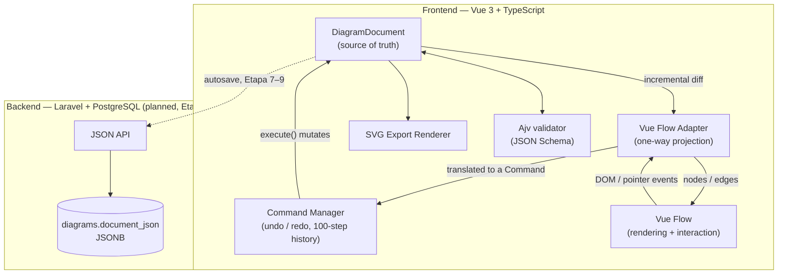
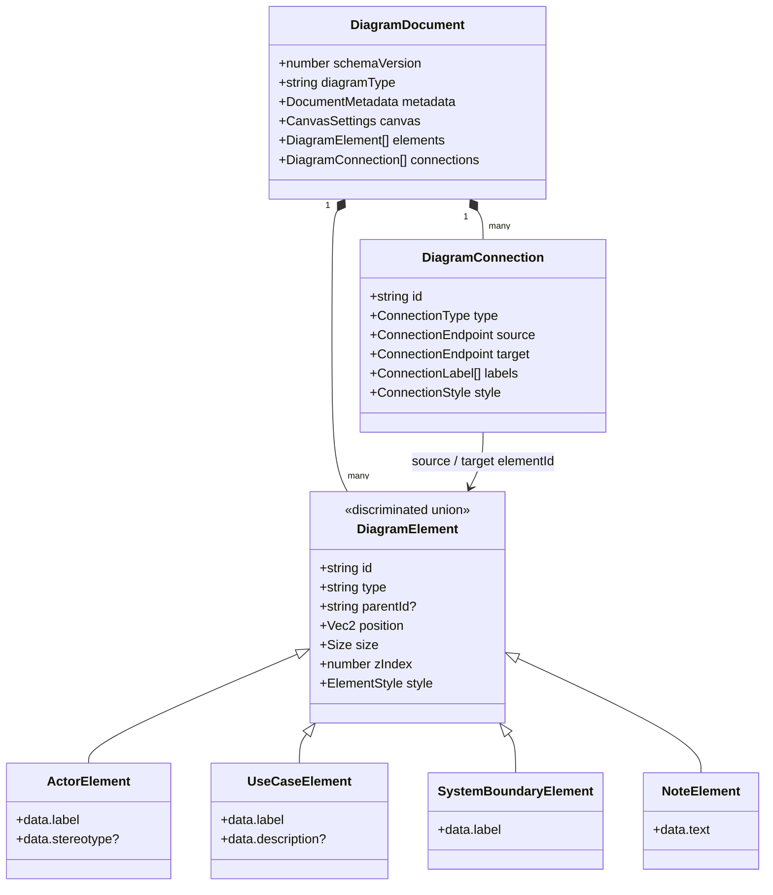
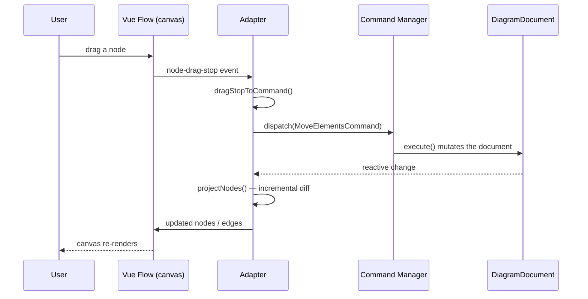
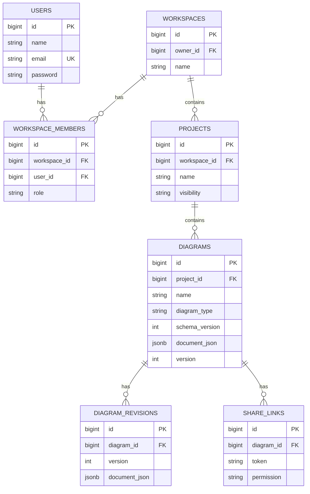

# ni-uml 🟢

> An open-source, **UML-first** diagram editor — free-form visual modeling combined with real UML semantics, validation, and an open, versioned document format.

`ni-uml` is not another draw.io clone. It doesn't just let you draw ovals and boxes — every element understands what it *is*. An `include` connection knows it must point at the included use case. An actor placed inside a system boundary gets a warning, not silence. The document you save is a plain, versioned JSON file you can read, diff, and take with you — there is no proprietary lock-in.

---

## Status

🚧 **Active development.** Current milestone: `Etapa 6` (properties panel). Project foundation, document model, command system, and a fully interactive Vue Flow-based Use Case editor (add / move / resize / connect / reparent / undo-redo / SVG export) are complete and running.

Full staged plan: [`docs/plan.md`](docs/plan.md) · Product analysis: [`docs/analysis.md`](docs/analysis.md) · Architecture decisions: [`docs/adr/`](docs/adr/)

---

## Why not draw.io?

draw.io is free, open-source, and self-hostable — so "free alternative to draw.io" is a weak and inaccurate pitch. The actual differentiation:

- **UML-aware elements** — an actor, a use case, and a system boundary are distinct typed entities, not generic shapes with different fill colors.
- **Semantic validation** — structural errors (a connection to a non-existent element) block nothing silently; domain warnings (an actor without a name, an actor inside a boundary) surface without blocking the user.
- **One shared visual source of truth** — the on-screen editor and the exported SVG read the *same* geometry and style constants. What you see is what you export, by construction, not by manual syncing.
- **Open, versioned document format** — `schemaVersion` on every document, a migration chain from day one, JSON Schema validated on both save and load.
- **Self-hostable, pluggable core** — Use Case is the first diagram type installed on a generic node/edge engine, not a hardcoded editor with ovals and stick figures baked into the canvas logic.

---

## Features

### MVP Core — implemented

- [x] Actor, use case, system boundary, and note elements
- [x] Association, include, extend, and generalization connections — correct line style, arrowhead, and auto-label per UML convention
- [x] Move, resize, delete, undo/redo (100-step history)
- [x] Reparenting by drag (into and out of a system boundary), with correct relative → absolute coordinate translation
- [x] Registry-driven toolbar — adding a node/edge type to the plugin registry adds it to the UI automatically, no component changes required
- [x] Zoom, pan, fit-view, snap-to-grid
- [x] Keyboard shortcuts (undo / redo / delete / escape)
- [x] JSON Schema (Ajv) validation on parse, plus a separate referential-integrity check for dangling connections
- [x] Deterministic SVG export straight from the document model (not from the DOM)
- [ ] Properties panel + inline text editing — in progress (`Etapa 6`)

### Planned

- Local autosave + recovery, then Laravel-backed persistence with optimistic locking and conflict resolution
- Full UML validation engine with a validation panel (click a warning → jump to the element)
- PNG export, snapshot-tested SVG export for every element/connection type
- A second, minimal diagram-type plugin to prove the core is genuinely generic (no `if diagramType === 'uml-use-case'` scattered through the engine)
- Multi-selection, copy/paste, alignment tools, JSON import, revision history
- Public self-hosted release: Docker Compose, install docs, security hardening

Full breakdown: [`docs/plan.md`](docs/plan.md) and [`docs/agent-work-packages.md`](docs/agent-work-packages.md).

---

## Architecture

The single rule the whole codebase is built around: **`DiagramDocument` is the source of truth. Everything else is a projection of it.**



Vue Flow is never mutated directly and never holds state Command Manager doesn't know about — every user action becomes a `Command` object with `execute()` / `undo()`, dispatched through `CommandManager`, which mutates `DiagramDocument`. The Vue Flow projection (`resources/js/editor/adapter/vueflow-adapter.ts`) then re-derives only the nodes/edges that actually changed, so a 200-element diagram doesn't re-render on every drag frame.

### The document model



A child element's `position` is stored **relative to its parent** (matching Vue Flow's `parentNode` semantics); absolute canvas coordinates are resolved by walking the parent chain (`resources/js/editor/geometry/geometry.ts`). Every document carries `schemaVersion`; `resources/js/editor/serialization/serializer.ts` runs Ajv against `schemas/diagram-document.v1.schema.json` before a migration chain (`v1 → v2 → …`, currently identity) ever touches it. Referential integrity of connections (`BR04` — a connection must reference an existing element) is *not* a JSON Schema concern and is checked separately, because a dangling `elementId` is structurally valid JSON.

### The interaction cycle



One pointer drag from press to release becomes **one** command — not one command per `pointermove` event — so undo/redo stays coherent and cheap.

### Plugin registry

Node and edge *types* are data, not code branches. `resources/js/editor/uml-use-case/definitions.ts` registers `uml.actor`, `uml.use-case`, `uml.system-boundary`, `uml.note`, and the four connection types, each with a shared `defaultSize`, `defaultStyle`, `anchors`, `minSize`, and (for edges) an automatic UML label. The toolbar, the element factory, and the SVG exporter all read from this one registry — adding a fifth element type does not require touching the toolbar component.

### Shared geometry, not shared code

The editor's `ActorNode.vue` and the SVG exporter both compute the stick-figure geometry from the same `ACTOR_GEOMETRY` ratio constants (head radius, shoulder height, hip height, leg spread). They are two independent renderers — one HTML/Vue, one raw SVG string — that are required to *look* identical, not to share markup. See [ADR-0003](docs/adr/0003-separate-svg-export-renderer.md).

---

## Tech stack

| Layer | Technology |
|---|---|
| Backend | Laravel 13 (PHP 8.4) |
| Bridge | Inertia.js |
| Frontend | Vue 3 (Composition API), TypeScript |
| Editor engine | Vue Flow (`@vue-flow/core`, `background`, `controls`, `node-resizer`) |
| Document validation | Ajv (JSON Schema) |
| Database | PostgreSQL 16, `JSONB` document storage |
| State | Pinia *(planned, Etapa 8)* |
| Unit / component tests | Vitest |
| Backend tests | Pest |
| E2E tests | Playwright |
| Lint / format | ESLint, Prettier, Laravel Pint |
| CI | GitHub Actions (lint + test on every push) |

---

## Planned relational schema (Etapa 8 — not yet implemented)

Diagram *content* is never normalized into rows — one diagram is one JSON aggregate (see [ADR-0004](docs/adr/0004-postgresql-jsonb.md)). Only ownership, membership, and revision metadata are relational.



`diagrams.version` backs optimistic locking: a save is accepted only if the client's `version` matches the server's; a mismatch returns `409 Conflict` rather than silently overwriting a concurrent edit (Etapa 9).

---

## Business rules & validation

A subset of the rules the domain model enforces (full list: [`docs/analysis.md`](docs/analysis.md) §9, §29):

| ID | Rule |
|---|---|
| BR01 | Every diagram belongs to exactly one project |
| BR03 | Every element has a stable, unique identifier |
| BR04 | A connection must reference an existing source and target element |
| BR05 | Deleting an element removes or reassigns its connections |
| BR12 | Generalization uses a hollow triangle on the more general element's side |
| BR14 | Visual position never determines an element's identity |
| BR17 | Every saved document carries a version number |

| Validation rule (planned, Etapa 10) | Severity |
|---|---|
| Use case / actor / boundary without a name | warning |
| Connection references a non-existent element | **error** |
| Circular container hierarchy | **error** |
| Actor placed inside a system boundary | warning |
| `include` / `extend` connects a non-use-case element | **error** |
| Generalization connects incompatible types | **error** |

Errors are structural problems that should block save/import; warnings are UML-style guidance that never blocks the user.

---

## Architecture decisions

Every non-obvious choice is recorded as an ADR — read these before assuming an alternative wasn't considered.

| ADR | Decision |
|---|---|
| [0001](docs/adr/0001-vue-flow-as-editor-engine.md) | Vue Flow is the interaction/rendering engine; we don't build a custom canvas engine |
| [0002](docs/adr/0002-diagram-document-source-of-truth.md) | `DiagramDocument` is the source of truth; Vue Flow state is a derived projection |
| [0003](docs/adr/0003-separate-svg-export-renderer.md) | The SVG exporter is a separate renderer that shares geometry/style constants with the editor, not markup |
| [0004](docs/adr/0004-postgresql-jsonb.md) | PostgreSQL + `JSONB` for diagram content; relational tables only for ownership/metadata |
| [0005](docs/adr/0005-project-license.md) | MIT license |
| [0006](docs/adr/0006-mvp-core-scope.md) | MVP Core vs. MVP Polish scope split |

---

## Engineering notes — real bugs, real lessons

Kept here deliberately, because they're the kind of thing a green test suite doesn't catch:

- **A `100×100` `viewBox` with `preserveAspectRatio="none"` on a non-square node distorts a circle into an ellipse.** The actor's head silently stopped being a circle once the node's real dimensions (70×110) stretched a square coordinate space. Fixed by computing geometry in the element's actual pixel dimensions — exactly what the SVG exporter already did.
- **Custom Vue Flow edges render in a DOM layer with no explicit `z-index`,** so `.vue-flow__edges` sits under every node's inline `z-index` by default CSS stacking rules — a connection into a system boundary was computed at the correct coordinates but was visually hidden underneath the boundary's opaque fill. Not a coordinate bug; a stacking-context bug.
- **`extent: 'parent'` on a Vue Flow node physically clamps drag movement inside the parent's bounds.** It quietly made "drag an element back out of a system boundary" impossible at the pointer level, regardless of how correct the reparenting command logic was — the drag gesture could never reach a point outside the parent to begin with.

None of these were caught by unit tests, because none of them are unit-testable in isolation — they only show up when you actually look at the rendered canvas. Every UI-facing package in this project's history has a mandatory manual visual verification step for exactly this reason.

---

## Installation

```bash
# Clone and install dependencies
git clone https://github.com/buhovac/ni-uml.git
cd ni-uml
composer install
npm install

# Configuration
cp .env.example .env
php artisan key:generate

# Database — PostgreSQL 16
# docker run -d --name ni-uml-pg -e POSTGRES_PASSWORD=secret \
#   -e POSTGRES_DB=ni_uml -p 5432:5432 postgres:16
php artisan migrate

# Run (dev)
composer run dev   # or: php artisan serve + npm run dev
```

The application runs on [Laravel Herd](https://herd.laravel.com) in development, reachable at `https://ni-uml.test`.

## Requirements

- PHP 8.4+
- Node.js 20+
- PostgreSQL 16+

## Testing

```bash
npm run test:unit      # Vitest — commands, model, geometry, serialization, export
npm run types:check    # vue-tsc
npm run lint:check     # ESLint
php artisan test       # Pest
npm run test:e2e       # Playwright
```

CI runs lint and both test suites on every push via GitHub Actions.

---

## Project structure

```text
app/                              # Laravel: controllers, models, policies (Etapa 8+)
docs/
├── analysis.md                   # Full product analysis and domain model
├── plan.md                       # Staged development plan (Etapa 0–15)
├── agent-work-packages.md        # Plan broken into session-sized work packages
└── adr/                          # Architecture Decision Records
schemas/
└── diagram-document.v1.schema.json
resources/js/
├── editor/
│   ├── types/                    # DiagramDocument, element/connection types
│   ├── commands/                 # Command interface, CommandManager, all commands
│   ├── geometry/                 # Absolute position, anchor points, bounds
│   ├── adapter/                  # DiagramDocument ↔ Vue Flow projection
│   ├── serialization/            # Ajv validation, migration chain
│   ├── export/                   # Deterministic SVG export, text wrapping
│   └── uml-use-case/
│       ├── definitions.ts        # The plugin registry — nodes, edges, styles
│       ├── factory.ts            # Element/connection creation (only entry point)
│       ├── nodes/                # ActorNode, UseCaseNode, SystemBoundaryNode, NoteNode
│       └── edges/                # UmlEdge (single parametrized component) + markers
├── components/                   # EditorTopBar, EditorToolbar, EditorCanvas, …
└── pages/
    └── Editor.vue
e2e/
└── editor-happy-path.spec.ts
```

---

## Roadmap

| Stage | Scope | Status |
|---|---|---|
| Etapa 0 | Project foundation, CI, ADRs, license | ✅ |
| Etapa 1 | Architecture spike — Vue Flow, document model, SVG export | ✅ |
| Etapa 2+3 | Document model, Ajv validation, command system | ✅ |
| Etapa 4+5 | Editor UX, registry-driven toolbar, UML plugin, resize | ✅ |
| Etapa 6 | Properties panel, inline text editing | 🔜 in progress |
| Etapa 7 | Local persistence & recovery | ⬜ |
| Etapa 8 | Laravel backend — auth, workspaces, projects, diagrams | ⬜ |
| Etapa 9 | Autosave, optimistic locking, conflict handling | ⬜ |
| Etapa 10 | UML validation engine | ⬜ |
| Etapa 11 | Production SVG/PNG/JSON export | ⬜ |
| Etapa 12 | MVP Core stabilization — **first public release** | ⬜ |
| Etapa 14 | Extensibility proof (second diagram-type plugin) | ⬜ |
| Etapa 13 | Polish — multi-select, alignment, revisions | ⬜ |
| Etapa 15 | Open-source production release | ⬜ |

Full detail, exit criteria, and rationale for the staged order: [`docs/plan.md`](docs/plan.md).

---

## License

MIT — see [LICENSE](LICENSE) and [ADR-0005](docs/adr/0005-project-license.md).

## Author

Marko Buhovac ([Nov Inicium](https://github.com/buhovac))
